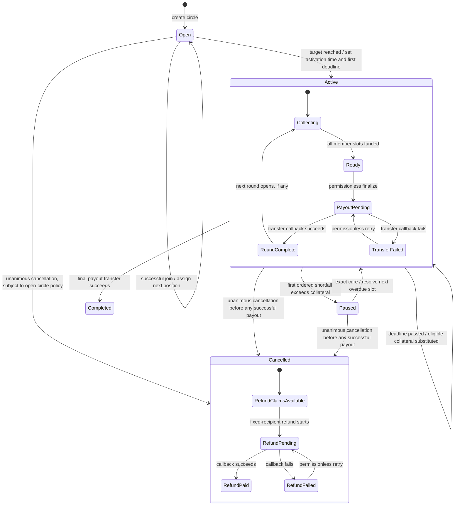

# Kutu DAO financial lifecycle design

**Status:** design decisions approved by the user and implemented incrementally in the current contract. Current implementation and tests are summarized here; production code is authoritative if a field name differs.

The approved MVP rules are: a hard maximum of 10 members, explicit creator joining, join-order payout positions, exact one-time contributions per member and round, permissionless payout finalization after full funding, eligible collateral substitution after the deadline, exact-payment cure, indefinite pause if unresolved, unanimous pre-payout cancellation, and separate storage funding. The user approved activation-based deadlines, intervals beginning after successful payout, and configurable targets from 2–10. This implementation remains incremental and is not Testnet deployed.

## 1. Deadline policy

### Option A: deadline begins at creation

The creator supplies or establishes an absolute first deadline when creating the circle. The countdown runs while the circle is Open and recruiting.

| Aspect | Effect |
|---|---|
| User experience | Every joiner sees the same calendar date, but a late joiner may have little time to contribute. A long recruitment period can consume the whole payment window. |
| Financial safety | No contribution is due while the circle is Open, but collateral can remain locked in an incomplete circle past the deadline. If the circle fills after the deadline, it can activate already overdue. |
| State complexity | Requires rules for an Open circle that reaches its deadline while underfilled: stop joining, extend/reset the deadline, expire it, or activate with an overdue round. Each choice needs refund and race handling. |
| Default processing | Must explicitly prohibit defaults until Active. If activation occurs after the deadline, the contract needs a special grace rule or members can become defaultable immediately. |
| Edge cases | A circle that never fills can strand collateral unless a separate Open-circle cancellation/expiry path exists. Resetting a deadline on joining can be manipulated and ceases to be a true creation-based deadline. |
| Contract complexity | Higher. It needs Open-deadline handling, expiry/cancellation behavior, and protection against activation after the deadline. |

### Option B: deadline begins at activation

The circle becomes Active on the final successful join to its configured target. At that block timestamp, the contract sets the first contribution window. No round contribution or default can occur while Open.

| Aspect | Effect |
|---|---|
| User experience | Every member receives a full, predictable contribution window after the circle fills. The creator must explicitly join like every other member. |
| Financial safety | Recruitment time cannot create an overdue first round. Defaults are possible only after activation and the full contribution deadline. Open-circle collateral still needs a cancellation/abandonment rule. |
| State complexity | Lower. Store `activated_at_ns` and a computed first deadline; Open has no contribution/default clock. |
| Default processing | Gate default processing on `Active` or the specifically paused round and `block_timestamp > deadline_ns`. Never process defaults for Open circles. |
| Edge cases | Activation timestamp and deadline arithmetic need checked addition. If the final join fails, activation and the deadline must roll back. A slow payout can also affect later due dates, addressed below. |
| Contract complexity | Lower than Option A. It uses the existing join-to-Active transition and starts the clock atomically on that final join. |

### Selected policy (approved and implemented)

Use **Option B, activation-based**. The implemented first deadline is `activation_timestamp + payment_interval_ns`. Contributions are accepted while `now <= deadline`; default processing is permitted only when `now > deadline`.

The current create arguments accept `payment_interval_ns`; there is no caller-supplied absolute deadline.

**Later rounds:** the implemented next round opens only after the prior payout callback succeeds; its deadline is `payout_success_timestamp + payment_interval_ns`.

### Target membership

The hard cap is **10** and `max_members` is the immutable configured target, enforced as **2–10**. A circle activates only after all configured positions have joined.

## 2. Proposed lifecycle



`Cancelled` is terminal for new contributions and payouts. Refund transfers may still be pending or retryable. A circle may only enter `Completed` after every configured round payout has succeeded. A completed circle may then return each member's remaining collateral. Storage fees remain excluded from collateral refunds.

## 3. Detailed lifecycle and authorization

| Step | State/action | Who may call | Required checks and effects |
|---|---|---|---|
| 1. Create | `create_circle` → Open | Anyone | Validate names/description, target 2–10, positive exact contribution/collateral/interval, checked arithmetic, and separately attached storage funding. Creator is recorded but not enrolled. Rules and target are immutable after creation. |
| 2. Join | Open → Open or Active | Any account, including creator | Require an available slot, no duplicate account, exactly the configured collateral plus at least measured storage funding. Assign the next permanent one-based position. Last successful join atomically activates the circle and sets `activated_at_ns` and the first deadline. Excess storage allowance is a separate fixed-recipient refund. |
| 3. Contribute | Current round Collecting | That member only | Derive the member slot from `predecessor_account_id`; accept exactly the configured amount, exactly once, for the current round, before or at its deadline. Reject excess or short deposits; do not accept user-supplied member index/recipient. Record source as direct. |
| 4. Detect misses | After deadline | Permissionless | `process_defaults(circle_id)` only when `now > current_round.deadline_ns`. Iterate unpaid positions in ascending join order. Do not run for Open or for a different round. |
| 5. Collateral cover | Current round Collecting | Permissionless default processor | If the first unpaid member's remaining collateral is at least one full contribution, subtract exactly that amount from their collateral liability and record the same amount as that member's collateral-funded round contribution. No transfer occurs; this is an internal liability reclassification. Continue in order. A slot can be processed only once. |
| 6. Pause | Active → Paused | Permissionless processor detects the shortfall | If the next unpaid member's collateral is below a full contribution, deduct nothing. Record `AwaitingCure`, the round and member position, and pause the circle. Stop processing later positions so there is only one unresolved cure target at a time. Block new round activity, payouts, and automatic refunds. |
| 7. Cure | Paused → Active or Paused | Only the recorded defaulted member | Accept exactly one full contribution as new attached funds. Record it as a late direct cure, not as collateral substitution. Underpayment, overpayment, wrong account, wrong round, or duplicate cure reverts atomically. Clear that default, then continue ordered processing of the same overdue round; if another member lacks collateral, pause at that member. Resume normal progression once all missing slots are funded. There is no cure expiry in this proposal; a valid cure remains possible indefinitely. |
| 8. Ready/finalize payout | Ready → PayoutPending | Anyone | Ready means every member slot is funded exactly once. Derive recipient from `round.number + 1` and the immutable member vector; compute amount as `target_members × exact_contribution` with checked arithmetic. Set the round and transfer slot Pending, fixed ID, recipient reference, amount, and attempt before scheduling the promise. No caller supplies the recipient or amount. |
| 9. Payout transfer | Pending → Finalized or Failed | Private callback only | Callback requires the current contract as predecessor, exactly one promise result, correct transfer slot/kind, globally unique ID, current attempt, and Pending state. Success consumes that round's escrow liability and advances the round or completes the circle. Failure releases the in-flight reservation and leaves the same funded round escrow available for retry. |
| 10. Retry | Failed → Pending | Anyone | Require the exact failed operation ID and correct transfer kind. Reuse saved amount and recipient; increment attempt with checked arithmetic. Reject calls while Pending, after success, or after cancellation. No retry parameter can redirect funds. |
| 11. Deposit refund | Completed → refund paid/failed | Recommended permissionless fixed-recipient claim | Only after all rounds paid successfully. Refund only that member's remaining collateral. Reserve it before transfer; success marks it paid, failure preserves it in the same failed transfer claim. A fixed account/position is used. No contributions are included because they were paid out. |
| 12. Consent/cancellation | Active, Paused, or eligible Open → Cancelled | Approval/revocation by each member; finalization permissionless | Each existing member explicitly approves on-chain and may revoke until finalization. Finalization requires unanimity, zero successful payouts, no payout in Pending, and no prior cancellation. Freeze every member's amount before any refund can start. A successful prior payout permanently prevents full-refund cancellation. |
| 13. Cancellation refund | Cancelled → per-member paid/failed | Permissionless fixed-recipient claim | Transfer each frozen member entitlement through a preallocated cancellation-refund slot. Success consumes the liability; failure leaves the same claim retryable. If a member never consents, cancellation does not finalize and the circle remains Active or Paused with liabilities intact. No one can force consent or redirect funds. |

### Missed contributions and multiple defaults

The ordered, one-shortfall-at-a-time processing rule is a recommendation to avoid an arbitrary caller selecting which member's collateral is deducted and to keep one cure target in state. A processing call may cover several earlier members' full contributions before reaching an insufficient balance, then stops at that member. After cure, processing continues in join order. The max of 10 bounds the loop and storage.

No partial collateral deduction is allowed. If collateral is `q - 1` and the contribution is `q`, deduct zero and pause. The member may cure with exactly `q`; the remaining collateral then stays refundable. If collateral is at least `q`, exactly `q` is reclassified and the remaining balance stays collateral.

## 4. Accounting model

### Ownership and ledger categories

| Category | Ledger owner/meaning | When it changes |
|---|---|---|
| Security collateral | Refundable liability attributed to one member | Initially the exact deposit. Decreases only when a full collateral substitution is moved to a round or a refund transfer succeeds. A pending/failed refund is represented by its fixed transfer slot, not also by available collateral. |
| Direct contribution | A member-funded contribution held for one round | Increases only on an exact direct or cure payment. Remains in that round until payout success, or is included in a pre-payout cancellation refund. |
| Collateral-funded contribution | A reclassification from that same member's collateral into one round | Decrease collateral and increase the round funded amount by exactly `q` in the same state transition. It is never counted as both collateral and contribution. |
| Unreserved round escrow | Contributions not currently in an outgoing payout transfer | Sum of direct/cure amounts plus collateral substitutions for rounds not successfully paid, excluding any round payout currently Pending. |
| Pending outgoing | Amount reserved for a scheduled transfer whose callback has not settled | Transfer slot enters Pending before promise scheduling. No other method may spend the same amount. During the receipt chain, NEAR may already have debited a successful transfer before the callback updates state; reconcile it as an in-flight operation, not as available funds. |
| Failed refund claim | Non-payout refund entitlement still held by the contract | After failed deposit/cancellation/storage refund callback, the amount remains in the same Failed transfer slot and is retryable. It is not also counted in `collateral_remaining` or another refund total. |
| Storage cost | Contract storage stake/cost funded separately at create/join | Creation/join measures actual stored bytes and current protocol byte cost. This cost is not collateral, contribution, payout escrow, or a guaranteed refund while records remain. |
| Excess storage allowance | Creator/member claim for attached funds above measured storage cost | Stored in a separate fixed-recipient transfer slot. Pending and Failed states represent one claim; retry reuses it. It is excluded from collateral and contribution balances. |

### Contribution and payout arithmetic

Let `N` be the immutable target and `q` the exact contribution. For every round `r`, each member slot is exactly one of `Unpaid`, `Direct`, `Cure`, or `CollateralSubstitution`. A paid slot has amount exactly `q`; an unpaid slot has amount zero. No slot may have two sources.

```text
round_funded[r] = Σ member_slot.amount
ready(r)        = every member slot has one funded source
payout_amount   = N × q
```

`round_funded[r]` must equal `N × q` before payout scheduling. Checked arithmetic guards the multiplication and addition. At payout start, the contract marks that round's escrow reserved and increases pending outgoing by exactly the same amount. On success, both the payout liability and pending reservation are discharged once. On failure, pending decreases and the amount becomes available in the same round escrow again.

### Collateral and cancellation arithmetic

For member `m` before refunds:

```text
initial_collateral[m]
  = collateral_remaining[m]
  + Σ collateral_substitution[m, r]
  + collateral_refund_pending_or_failed[m]
  + collateral_refund_succeeded[m]
```

The terms are mutually exclusive ledger locations at a given instant. Successful refund is historical/outflow, not a current contract liability. `initial_collateral` can be derived from the immutable circle security-deposit amount for a member that joined successfully.

If cancellation is allowed (no successful payout and no payout Pending), freeze:

```text
cancellation_refund[m]
  = collateral_remaining[m]
  + Σ direct_or_cure_contributions[m, r]
  + Σ collateral_substitutions[m, r]
```

Each collateral substitution has already been removed from `collateral_remaining`, so the sum does not double-count it. Storage cost and excess-storage claims are excluded. Since no payout succeeded, every contribution remains available for these refunds. Once frozen, the entitlement cannot be recomputed or changed by retries.

After Completed, deposit refund is only `collateral_remaining[m]`; contributions are not refunded because successful payout transfers already consumed them. A Pending/Failed deposit refund occupies the transfer slot and is not simultaneously claimable as collateral.

### Solvency and conservation checks

At settled transaction boundaries, current contract-held financial liabilities must reconcile to:

```text
remaining collateral liabilities
+ unreserved round contribution escrow
+ pending outgoing claims not yet callback-settled
+ failed non-payout refund claims
+ any other explicitly recorded member liability
```

During an asynchronous receipt chain, the Pending transfer may already have left the contract account but its callback has not yet changed state. The contract must still reserve that amount in state and block reuse. Track in-flight transfers separately in audit/reporting; do not assert that the instantaneous contract balance always covers a Pending payment that has already executed. Storage stake is a separate backing requirement based on contract storage usage and is not spendable financial float.

Useful invariant checks after every native-model transition:

1. A member/round has at most one contribution source and at most `q` recorded.
2. `round.total_collected` equals the sum of all member slots.
3. Collateral only decreases by exactly a recorded substitution or moves into its unique refund transfer.
4. A payout amount equals the fully funded round and one round can succeed at most once.
5. A Pending transfer has one ID, one recipient, one amount, and one current attempt; retries change only attempt/state.
6. Pending totals equal the sum of slots in Pending state, with payout round escrow excluded from available escrow while pending.
7. Cancellation requires zero successful payouts, no payout Pending, unanimity, and frozen refund entitlements; cancellation refunds sum to all remaining collateral and unpaid contribution escrow, excluding storage claims.

## 5. Proposed contract architecture

This extends the existing `Contract` → `LookupMap<u64, Circle>` architecture. It preserves the approved maximum and uses the current preallocation strategy: each circle allocates at most `N` rounds, each round at most `N` member slots, and each transfer slot before lifecycle execution. Avoid appending unbounded vectors during contributions, defaults, callbacks, or refunds.

### Proposed structures and fields

```text
Contract
  schema_version: u16
  next_circle_id: u64
  next_transfer_id: u64
  total_pending_outgoing_yocto: u128
  total_storage_cost_funded_yocto: u128
  circles: LookupMap<u64, Circle>

Circle
  id, creator, name, description
  target_members: u32              // hard constrained to <= 10
  contribution_yocto, security_deposit_yocto: u128
  first_contribution_window_ns, payment_interval_ns: u64
  activated_at_ns: u64              // zero until target is reached
  status: CircleStatus
  members: Vec<Member>              // append only before activation
  rounds: Vec<Round>                // preallocated to target
  current_round: u32
  paused_round: u32
  paused_member_position: u32
  successful_payout_count: u32       // monotonic; cancellation gate
  storage bytes/cost plus excess-storage refund slot

Member
  account_id, payout_position
  collateral_remaining_yocto: u128
  total_contributions_yocto, total_payouts_yocto: u128
  status / cancellation_approved
  deposit_refund: PendingTransfer
  cancellation_refund: PendingTransfer
  storage_bytes_added, storage_cost_paid_yocto
  storage_allowance_refund: PendingTransfer

Round
  number, recipient_position, opened_at_ns, deadline_ns
  status: Collecting | Ready | PayoutPending | TransferFailed | Finalized
  contributions: Vec<RoundMemberContribution> // exactly target slots
  total_collected_yocto: u128
  payout: PendingTransfer
  finalized_at_ns

RoundMemberContribution
  amount_yocto: u128                // zero or exactly circle contribution
  source: Unpaid | Direct | Cure | CollateralSubstitution
  default_state: NotProcessed | AwaitingCure | Cured | CollateralApplied

PendingTransfer
  id: u64
  kind: Payout | DepositRefund | StorageAllowanceRefund | CancellationRefund
  recipient: immutable Creator or MemberPosition reference
  amount_yocto: u128
  state: NotStarted | Pending | Succeeded | Failed
  attempts: u32
```

The existing separate `direct_payments_yocto` and `collateral_substitutions_yocto` arrays could be retained instead of `RoundMemberContribution`; the latter groups the mutually exclusive source and status, reducing opportunities for contradictory slots. Either representation must make a direct/cure payment mutually exclusive with collateral substitution. Keep transfer recipients position-based only while member positions are immutable; never add member removal or position editing.

### Proposed methods

| Method | Payable | Authorization |
|---|---:|---|
| `create_circle(args)` | Yes, storage only | Public |
| `join_circle(circle_id)` | Yes, exact collateral + separate storage | Public; account is caller |
| `contribute(circle_id)` | Yes, exact contribution | Current member only; derive own position |
| `process_defaults(circle_id)` | No | Permissionless after deadline |
| `cure_default(circle_id)` | Yes, exact contribution | Only currently recorded defaulted member |
| `finalize_payout(circle_id)` | No | Permissionless when current round fully funded |
| `retry_transfer(circle_id, slot, transfer_id)` | No | Permissionless; transfer destination/value fixed |
| `approve_cancellation(circle_id)` | No | Member only |
| `revoke_cancellation(circle_id)` | No | Member only, before finalization |
| `finalize_cancellation(circle_id)` | No | Permissionless; contract checks unanimity and payout gate |
| `claim_cancellation_refund(circle_id, position)` | No | Recommended permissionless; recipient fixed to that position |
| `claim_deposit_refund(circle_id)` | No | Member or permissionless fixed-recipient claim, only Completed |
| `on_transfer_result(...)` | No | Private callback only |

Avoid accepting user-supplied payout recipients, claim account IDs, arbitrary amounts, or member indexes for contribution authorization. If a permissionless refund method takes a position to identify a slot, the recipient still comes exclusively from that saved member record.

### Views

Add bounded views before frontend integration:

- `get_circle(circle_id)` — immutable rules, status, target, activation/deadlines, current round, and storage cost.
- `get_members(circle_id)` — join order, one-based payout positions, account IDs, collateral remainder, and member status; paginate if the API later aggregates multiple circles.
- `get_round(circle_id, round_number)` — deadline, per-position contribution source/amount, default state, funded total, payout state.
- `get_member_accounting(circle_id, account_id)` — caller's collateral, direct/cure contributions, collateral substitutions, payout/refund status, pending/failed claims.
- `get_transfer(circle_id, slot)` — state, ID, attempt, fixed recipient and amount, without exposing any key material (none is stored).

Views are informational only and never the authority for a transaction's amount or eligibility. The contract rechecks all conditions in state-changing methods.

### Events

Emit NEP-297 structured events for `circle_created`, `member_joined`, `circle_activated`, `contribution_recorded`, `default_collateral_applied`, `circle_paused`, `default_cured`, `payout_started`, `payout_succeeded`, `transfer_failed`, `transfer_retried`, `cancellation_approved`, `circle_cancelled`, `refund_started`, `refund_succeeded`, and `circle_completed`. Include schema/event version and identifiers/amount strings. Logs support indexing and user feedback; they are not a substitute for contract state.

### Callback and async-transfer safety

Keep one reusable callback, but dispatch by an explicit transfer slot/kind to the correct preallocated record (payout, deposit refund, cancellation refund, or storage excess). At scheduling time, persist operation ID, fixed amount, fixed recipient reference, and attempt, mark Pending, reserve the amount, then create the transfer and callback promises. The callback validates private caller, exactly one promise result, circle/slot existence, kind, ID, attempt, and Pending state before applying one state transition. A stale/duplicate callback must revert before changing any totals.

On success, settle the source liability exactly once. On failure, restore a payout to that round's escrow; for a collateral/cancellation/storage refund, keep the amount as a Failed claim in that transfer slot. Retry accepts no replacement recipient or amount and increments the attempt. Do not allow retries from Pending or Succeeded. Never resolve a Pending transfer by allowing arbitrary user resends: if callback execution itself fails after the transfer receipt succeeded, the outcome is ambiguous on-chain and retry could duplicate a payment. Therefore callbacks must stay small, have a measured gas budget at the 10-member maximum, and have sandbox tests for callback execution. A callback that exhausts its gas is a release-blocking incident to prevent by design/testing; there is no safe general-purpose way to infer that transfer result later from contract balance alone.

### Security considerations

- This MVP transfers native NEAR only; it has no fungible-token registration flow. Each member account exists when they sign a join, but a member may later delete that account. Treat a transfer failure to a deleted/unreceivable account as a retained, fixed-recipient claim and test the failure/retry behavior in Sandbox before release.
- NEAR promise chains are asynchronous, not atomic across receipts. State must be Pending before a transfer is scheduled. During Pending, all other operations must treat the entitlement as reserved even if the callback has not yet run.
- A transfer receipt can succeed while its callback fails. That case can strand the transfer slot in Pending; retrying it would risk double payment. Keep callbacks minimal, give them a verified gas budget, and make callback-out-of-gas a release blocker. Do not add an admin “force settle” or arbitrary balance-based reconciliation path.
- No admin key may alter payout recipients, skip unanimous consent, withdraw pooled funds, or recover a paused circle. Emergency handling in this MVP is limited to exact cure, unanimous cancellation before any successful payout, and retrying the saved transfer.
- All state-changing paths must keep lifecycle updates within storage allocated/funded at creation and join. If a future field/vector grows persistent state, it needs separate measured storage funding; collateral and contributions cannot fund it.

## 6. Serialized-state compatibility

Current `Circle`, `Member`, `Round`, enums, and `Contract` are Borsh-serialized and are not yet the complete financial schema. Adding fields to a Borsh struct or reordering/changing enum variants is not a safe in-place migration by default.

**Recommendation before first Testnet deployment:** finalize the financial structs and enum variants before deploying. Since the current milestone has no approved Testnet deployment, use a fresh contract account for the first financial build. If this prototype has already been deployed anywhere, do not overwrite it with the new schema; either use a fresh account or write a separately tested private migration that deserializes the exact old structs. After first deployment, freeze `V1` types and add a versioned state envelope or explicit `migrate_vN_to_vN+1` method for later schema changes. Test migration with a serialized fixture from the exact prior Wasm version. Never treat an enum extension or field addition as automatically compatible.

## 7. Test strategy

Native tests prove deterministic state/accounting logic and are fast. They do **not** execute optimized Wasm or real promise receipts. Sandbox tests execute the optimized Wasm, actual storage/gas behavior, and receipt/callback chains. Both are required; neither is Testnet evidence.

| Scenario | Native unit/model coverage | Optimized-WASM Sandbox coverage |
|---|---|---|
| Create, explicit creator join, target reached, join order | Exact state, IDs, positions, activation timestamp, rules immutable | Deploy Wasm; join several accounts; inspect views/events and max 10 |
| Target boundaries and UTF-8/input limits | 1/2/10/11 targets as approved; byte boundaries; zero/overflow amounts and timestamps | Reject invalid target/text/storage deposit atomically |
| Exact contribution | Correct current member/current round succeeds; short/excess/zero/duplicate/wrong account/future round fails | Real payable calls and state view confirm exact funded slot; verify failed transaction leaves slot unchanged |
| Deadline boundary | `now == deadline` contribution accepted; `now > deadline` rejected; default opposite boundary | Advance sandbox blocks/timestamp to boundary and confirm call outcomes |
| Missed payment/collateral | Full collateral reclassified once; below-q collateral deducts zero and pauses; repeated processor no duplicate | Execute post-deadline processor in Wasm; inspect member and round state |
| Cure | Only paused target, exact q; under/over/wrong member/duplicate rejected; source is Cure, collateral unchanged; repeated/next default resolution | Actual payable cure, pause recovery and next default sequence |
| Payout authorization/accounting | Caller cannot select recipient/amount; total equals N×q; one round only; recipient position fixed | Optimized WASM payout executes to expected join-order member; verify balances and views |
| Async success/failure | Simulate promise success/failure; exact ledger transitions | Exercise actual success and a deliberately failing recipient/transfer receipt; verify callbacks and balances |
| Duplicate/stale callback and retry | Wrong ID/slot/kind/attempt, duplicate callback, retry while Pending/Succeeded all reject; same ID/recipient/amount on retry | Callback privacy; actual failed transfer, permissionless retry, success; stale invocation rejected |
| Callback gas/storage | Fixed-width state and maximum circle data mutation; checked totals | Measure callback gas at 10 members and worst-case stored circle; make callback failure/out-of-gas a release gate |
| Deposit refund | Only Completed; amount is remaining collateral once; failure keeps retry claim; no contribution double count | Success/failure/retry receipts and destination balance |
| Unanimous cancellation | Each member approval, revocation, non-unanimity, successful-payout gate, pending-payout gate, frozen refund total | On-chain unanimous approvals, permissionless finalize, claims fixed to recipients |
| Cancellation accounting | Example with remaining collateral + direct + cure + substitution; prove substitution removed from collateral before adding escrow; storage/refund claims excluded | Compare contract views and sum claims to account outflows |
| Paused circle | No contributions except exact cure, no payouts, no refunds; no administrator path; unresolved state stable | Attempt blocked operations from several accounts; confirm only target cure works |
| Storage and conservation | Storage never debited from collateral/contributions; `total_pending` equals pending slots; overflow/underfunding rolls back | Measure storage/gas; insufficient attached funds do not consume member position/ID; excess refund success/failure |

For every state-changing method, tests should assert before/after ledger deltas, not only return values. Add a reusable invariant helper that sums member-round slots, collateral substitutions, pending/failed transfers, and frozen refunds and checks each source is counted once. Sandbox failed-receipt setup must be validated against the current NEAR Sandbox APIs rather than simulated by native callbacks alone.

## 8. Remaining product and security concerns

The product choices listed in the initial design are now resolved as described above. Remaining technical concerns are:

1. **Callback resource margin:** current end-to-end Sandbox covers success, cancellation refunds, and callback processing, but worst-case callback gas should be tracked after any contract changes and compared with the protocol receipt limit.
2. **Recipient availability:** retry is permissionless and cannot redirect; a transfer still fails until the saved account can receive it. The entitlement remains on chain.
3. **Consent liveness:** if any member never approves, cancellation remains impossible by policy. No timeout or administrator override exists.
4. **Storage retention:** records are not pruned, so storage costs are not fully refundable while state remains.
5. **Serialized state:** Borsh schema changes are not automatically compatible. No migration is included; use a fresh contract account for this pre-deployment prototype. A later upgrade needs a separately tested versioned migration.
6. **Testnet release gate:** successful local Sandbox execution does not replace Testnet integration review or authorize deployment.

## 9. Implementation milestones in dependency order

1. **Keep schema versioning explicit.** Maintain serialized fixtures and require fresh deployment or a separately reviewed migration after Borsh changes.
2. **Maintain native accounting invariants.** On each change, test contribution source exclusivity, collateral reclassification, default order, cure/pause/resume and payout progression.
3. **Maintain optimized-Wasm coverage.** Exercise 10-member storage/gas, asynchronous callback, default/cure, cancellation/refund and failures where Sandbox supports them.
4. **Finish the release audit.** Review actual contract code and observed tests; specifically evaluate worst-case callback gas, refund retries and balance/ledger reconciliation.
5. **Only then plan Testnet integration.** This implementation has not been deployed; deployment requires its own explicit approved milestone.

---

This document records the approved lifecycle design and the corresponding implementation. It does not claim formal verification and does not authorize or indicate a Testnet deployment.
